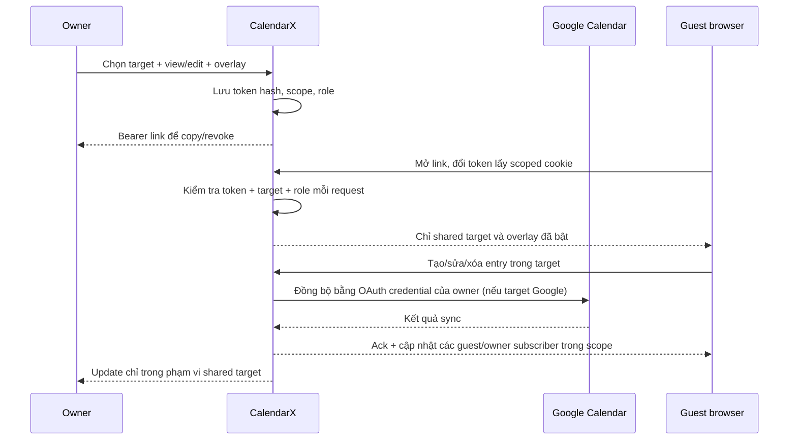

# Spec: CalendarX Minimalist và cộng tác qua link

## Context Snapshot

- Project/module: owner fork của Mitra, worktree `D:\pcloud\workspace\code\_spec-worktrees\calendarx`; base `e2a074563f00ffbb2cd154d76cc67892c754c37d`.
- Stack: Node 26+, TypeScript, Lit, Express, MikroORM/SQLite; repo khóa bằng `package-lock.json`; kiểm tra bằng `npm test`, `npm run typecheck`, `npm run build`.
- Current behavior: Calendar có events/tasks, nhiều view, Google/CalDAV và nguồn local. Theme hiện là `system/light/dark`. Sidebar đã lưu `Mitra.SidebarCollapsed` vào `localStorage` trên desktop từ 800px; owner nói có vẻ đang hoạt động trên cùng desktop/browser. Brand row ở sidebar còn Mitra và version/update/news indicators.
- Sharing hiện tại: owner đăng nhập vào Mitra và kết nối Google bằng OAuth. Chưa thấy application-level share link cho người ngoài. Google OAuth scope hiện là `openid email https://www.googleapis.com/auth/calendar`; token refresh ở server.
- Desired behavior: tên CalendarX, theme Minimalist có thể chọn và là default nếu owner chưa tự chọn; app icon/tab dùng `calendar_month`; người nhận link xem hoặc sửa không cần account; guest-created events sync qua credential của owner vào target đã chọn; event link mở đúng event nhưng giữ scope của shared calendar.
- Relevant files: `src/app/ThemeSetting.ts`, `src/app/Sidebar.ts`, `src/features/calendar/client/PageCalendar.ts`, `src/app/Mitra.ts`, `src/app/pwa.ts`, `scripts/indexHtml.ts`, `assets/mitra.svg`, `src/features/entries/server/CreateEntry.ts`, `UpdateEntry.ts`, `DeleteEntry.ts`, `src/integrations/google/server/GoogleOAuth.ts`, `src/infrastructure/operations/server/operationsRouter.ts`, `src/infrastructure/realtime/Updates.ts`, `src/infrastructure/realtime/events.ts`.
- Existing constraints: AGPL-3.0; không đổi Google OAuth ownership hay gửi refresh token xuống browser. Mỗi bearer link là quyền truy cập có thể forward; không cung cấp danh tính guest đã xác minh. Hidden personal calendars phải bị lọc server-side, không chỉ CSS.

## Objective

Biến Mitra thành CalendarX có giao diện Minimalist đúng gu của owner và cho phép cộng tác qua link mà không tạo account. Link chỉ cấp quyền vào đúng calendar target; các calendar cá nhân khác vẫn ẩn mặc định và không bị lộ qua API.

## Scope

- In:
  - Appearance preset `Minimalist` với nền trắng, chữ đen/xám, hover xám nhẹ; set làm default cho user chưa lưu lựa chọn. Giữ dark/system và style hiện có làm lựa chọn khác.
  - Đổi tên và brand user-facing thành CalendarX; icon app/tab/PWA lấy từ Material Symbols `calendar_month`.
  - Bỏ text version/build khỏi sidebar brand row và chuyển thông tin tra cứu vào About; giữ update/news dots và cách mở What's New.
  - Kiểm tra sidebar state hiện có trên cùng desktop/browser; chỉ sửa nếu repro chứng minh nó reset. Không thêm account-sync setting.
  - Share target chọn được: (1) dedicated Google Calendar, mặc định; (2) Google Calendar có sẵn do owner chọn; (3) nguồn CalendarX-only không sync Google.
  - Link role `view` hoặc `edit`; link có thể thu hồi. Edit cho phép đầy đủ CRUD events/tasks bên trong shared target nhưng không quản lý Google OAuth, account, hay link của owner.
  - Có tùy chọn overlay các calendar khác của owner ở chế độ read-only; mặc định ẩn. Hidden nghĩa là guest API không trả các event đó. Nếu chọn một Google Calendar có sẵn làm target, toàn bộ event trong target nằm trong phạm vi link; giao diện phải nói rõ trước khi bật edit.
  - Event share tạo link mở đúng event/ngày nhưng dùng quyền của shared calendar đã chọn. Không tạo một token có quyền rộng hơn calendar link.
  - Giữ ghi nhận nguồn/link đã tạo event để owner biết event đến từ shared capability nào; không giả tên hoặc email guest.
  - Security, rate limiting, token revocation và integration tests.
- Out:
  - Login/account riêng cho guest, email invitation, user directory hay audit danh tính con người.
  - Link ghi được vào toàn bộ calendars của owner hoặc dùng owner OAuth trong browser.
  - Cross-device sidebar sync, đổi cơ chế Google OAuth, public marketing page, hoặc gỡ/di chuyển dữ liệu hiện có.
  - Gửi Google refresh token/client secret cho guest.

## UX Baseline

1. Keyboard: Tab đi theo thứ tự nhìn thấy; Enter kích hoạt; Escape đóng dialog/menu.
2. Focus: keyboard focus rõ bằng cue trung tính; pointer focus không tạo vòng đen.
3. A11y: label gắn control; lỗi có announcement; text contrast tối thiểu 4.5:1; target chạm tối thiểu 44px.
4. Viewport: không tràn ngang 320–1440px; sidebar/menu reflow mà không che event chính.
5. States: empty/loading/error/success/revoked link có trạng thái thật và cách phục hồi.
6. Consistency: token dùng từ `src/design/theme.css.ts`; không hardcode palette rải rác.
7. Platform: web/PWA; scroll và native browser controls vẫn dùng được; `prefers-reduced-motion` được tôn trọng.
8. Copy: gọi đúng hành động; copy link thành công hiện trên chính nút; chỉ giữ câu cảnh báo cần để hiểu quyền link.

## Thuật ngữ

- **Share target**: đúng một calendar/source mà bearer link có quyền truy cập.
- **Bearer link**: URL giữ secret capability; ai cầm link thì dùng được quyền gắn với link.
- **Owner overlay**: calendar ngoài share target, chỉ được trả về khi owner bật hiển thị; luôn read-only.
- **CalendarX-only**: source lưu trong Mitra, không đồng bộ ra Google.
- **Event link**: deep link tới một event; URL này không làm thay đổi phạm vi quyền của share target.
- **Guest principal**: context ẩn danh gắn `capabilityId`, `targetSourceId`, role và owner data scope; không phải owner session, `User` account giả, hay `User.default`.

## Assumptions

1. Vì owner nói “thêm theme”, Minimalist được thêm như một lựa chọn mới và là default khi chưa có preference; preference đã lưu không bị ghi đè.
2. Default share target là dedicated Google Calendar; owner có thể đổi sang calendar Google sẵn có hoặc CalendarX-only trước khi tạo link.
3. Khi link được cấu hình để hiện calendars khác của owner, chúng chỉ đọc; quyền edit luôn giới hạn ở target.
4. Link sống tới khi owner revoke; expiry tự động không nằm trong scope.
5. Sidebar persistence chỉ cần giữ trong cùng browser/profile trên desktop; code hiện tại đã lưu trạng thái nên acceptance cho phép no-op nếu behavior pass.
6. Target ID được đóng băng trong capability; target bị xóa, mất quyền hoặc disconnect thì link báo unavailable, không tự rebind sang calendar khác. Dedicated Google Calendar là target mặc định đã được owner tạo/chọn, không tự tạo một lịch mới mỗi link.
7. Overlay set do owner quản lý theo capability, mặc định rỗng; owner đổi thì có hiệu lực từ request/stream tiếp theo, guest không thể sửa danh sách overlay.

## Open Questions

- Nếu Google Calendar API không cho tạo dedicated calendar theo flow hiện tại, T2 phải cung cấp lựa chọn tạo calendar hoặc chọn một calendar có sẵn; không tự hạ target thành lịch cá nhân.
- Realtime transport cho guest updates phải reuse/extend `src/infrastructure/realtime/Updates.ts` nếu nó đáp ứng isolation theo share scope; nếu không, ghi rõ polling/latency trade-off trước khi chọn transport.
- T2/T3 phải khóa route guest riêng `/s` (đăng ký trước `/:view`) và bootstrap không gọi owner `session.fetchUser()`/`Calendars.fetch()`; không được mở rộng `permitAll` cho operation API.

## Approach

- Chọn một capability riêng cho mỗi shared target; token có entropy cao, lưu hash ở server, gắn owner + target + role + overlay selection + revoked state. URL dùng fragment để trao token lần đầu rồi đổi lấy cookie `HttpOnly; Secure; SameSite`; sau exchange, route lập tức `history.replaceState` xóa fragment khỏi URL hiện tại trước khi render/đi tiếp, không lưu token ở localStorage. Secret không đi vào query, referrer hay access log. Share page/response dùng `noindex` và `no-store`. Mọi request đọc/ghi phải kiểm tra token còn hiệu lực và map đúng target.
- Không bật `permitAll` cho operation API. T2 định nghĩa Guest principal riêng, không đưa guest vào `OperationContext.user` account-wide, không dùng owner session/token làm guest identity, và không tạo fake `User`/`User.default`. Mọi read/write/file/search/source-list/realtime path phải enforce `targetSourceId` ở server; UI ẩn không thay authorization.
- Relation graph phải được scope-filter hai đầu: không trả/đính kèm relation tới entry ngoài target/overlay đã cấp, và guest không được tạo/sửa relation tham chiếu entry riêng. File access và participant data cũng theo cùng scope.
- T2 đóng băng typed guest API/context và error contract cho create/list/revoke/exchange/read/write/stream, cùng enforcement point, trước khi T3 nối UI; test direct event-ID, list/range/search, relation, file, source enumeration và SSE bằng hai capability cùng owner nhưng scope khác nhau.
- Event CRUD đi qua server operation hiện có, rồi đồng bộ Google bằng credential của owner ở phía server. Token không rời server. `CalendarX-only` ghi vào source local; dedicated/existing Google target ghi đúng calendar được chọn.
- Owner overlays được chọn riêng khỏi write target, mặc định off. Khi off, backend không trả dữ liệu; khi on, API chỉ trả read-only projection và chỉ owner đổi được overlay set. Target ID không đổi; event link chỉ thêm event/focus date vào capability, disclosure nói rõ link mở toàn bộ shared calendar.
- Appearance dùng semantic tokens tập trung; màu event giữ lại như vạch mảnh vì đó là tín hiệu source, còn block/canvas và controls trung tính.

### Diagram



## Bỏ qua

- Không đưa event của lịch cá nhân vào một link “edit all” mặc định.
- Không đổi toàn bộ event source colors thành cùng một màu phẳng; chỉ bỏ fill màu lớn và giữ source marker mảnh.
- Không viết lại chức năng lịch, provider OAuth, hay task planner ngoài scope share target.

## Risks

- Link có thể bị forward; guest thật không xác minh được. Link revocation phải chặn request tiếp theo.
- Google API là nguồn dữ liệu thật; sync failure không được báo thành công giả hoặc tạo duplicate entry.
- Nếu hidden overlay chỉ bị ẩn ở client, event private vẫn đọc được qua API — đây là security failure.
- Một target Google hiện có có thể chứa lịch cá nhân; khi chọn làm target, edit role bao trùm mọi event trong target. Cảnh báo phải xuất hiện trước khi copy link.
- Update stream của Mitra hiện gắn user ID; guest channel phải phân tách theo share capability và target. Revoke phải đóng stream đang mở; không phát event nào sau khi revoke có hiệu lực.
- Entry relation graph hiện được đọc theo toàn bộ integrations của `User`; nếu guest bị ánh xạ vào owner `User`, relation tới lịch riêng có thể lộ nội dung qua response hoặc write. Đây là security blocker, không phải UI-only overlay issue.

## Task List

### T1 — Minimalist appearance, CalendarX identity, sidebar audit
- id: T1
- depends_on: []
- wave: 1
- risk: T2
- Acceptance:
  - `ThemeSetting` có thêm lựa chọn `Minimalist` và dùng làm fallback cho user chưa lưu preference; các lựa chọn `system`, `light`, `dark` hiện hữu vẫn dùng được.
  - Header, page title, README user-facing, tab/PWA name là CalendarX; favicon/app icon và notification badge từ Material Symbols `calendar_month`. Chỉ bỏ text version khỏi sidebar brand row; giữ update/news indicators `.dot`/`.news-dot` và luồng About/What's New. Giữ LICENSE, copyright và source-offer/legal links hiện có khi rebrand. Internal container/Compose identifiers remain unchanged.
  - Event blocks nền trung tính, source marker mảnh; calendar grid và selected/focus state vẫn đọc được. Muted text dùng token ≥4.5:1 (`#666` trên trắng); `#999` chỉ dành cho non-text như gridline/disabled icon.
  - New UI strings use the existing i18n pipeline; Vietnamese and English entries are complete and other locales follow the repository fallback without missing keys.
  - Sidebar được test trên cùng browser/profile ở desktop. Nếu pass thì không thay code; nếu reset được tái hiện thì sửa đúng persistence, không thêm cross-device sync.
- UX Contract: same saved view/sidebar state; hover/selected/focus/disabled states; text contrast ≥4.5:1; responsive 320–1440px.
- Skills: `ui-design`, `flow`, `mobile-responsive`, `impeccable`.
- Visual Ref: `docs/specs/SPEC-2026-11-10-calendarx-minimalist-sharing/visuals/surface-brief.md` và `visuals/wireframes/calendarx.svg`.
- Reproduce: `npm run i18n:generate && npm test && npm run typecheck && npm run build`.
- Verify: test theme fallback/migration, locale keys and sidebar persistence; run UI Gate B1–B4; capture current week with sidebar open/collapsed at 1440px and 375px.
- Files:
  - `src/app/ThemeSetting.ts` — pattern: existing per-device `deviceStorage` choice setting.
  - `src/design/theme.css.ts` — pattern: existing semantic theme variables.
  - `src/app/Sidebar.ts` — sidebar brand row/version/update/news indicators và key `Mitra.SidebarTab`.
  - `src/features/calendar/client/PageCalendar.ts` — key `Mitra.SidebarCollapsed`; chỉ sửa nếu same-browser repro fail.
  - `src/app/Mitra.ts`, `src/features/about/client/DialogAbout.ts`, `scripts/indexHtml.ts`, `assets/mitra.svg`, `assets/mitra-monochrome.svg`, `README.md` — pattern: current title/About, favicon/PWA/notification-badge generation and product documentation.
  - `src/integrations/mitra/MitraCalendar.ts` — default label for the local calendar source; do not rename user-created calendar names or source IDs.
  - `src/infrastructure/i18n/en.json`, `vi.json`, `keys.auto-generated.ts` — pattern: existing translation keys and generated locale type map.

### T2 — Scoped share capability and target authorization (parent-owned T4)
- id: T2
- depends_on: []
- wave: 1
- risk: T4
- Acceptance:
  - Owner can create/revoke a ≥256-bit CSPRNG link with role `view` or `edit` bound to exactly one selected target; only a hash is stored.
  - Fragment exchange issues `__Host-calendarx_share; Secure; HttpOnly; SameSite=Strict; Path=/; no Domain`, max-age 12h, bound to capability+target+role. The capability itself remains active until owner revokes; a new session requires reopening the link.
  - Eligible targets are dedicated Google Calendar, a selected existing Google Calendar, and CalendarX-only; existing Google target requires an explicit scope warning.
  - A Guest principal can read only the immutable target and owner-selected read-only overlays; it is separate from `OperationContext.user`, owner OIDC/session and `User.default`. No token/no role/revoked token/wrong target is denied server-side on every API request.
  - Hidden owner overlays are absent from every server response. Lists/ranges, direct event-ID reads, search, source enumeration, relations, attachments/files, participants and realtime are all scoped to target + enabled overlays; editing target never grants access to other integrations or owner settings.
  - Relations crossing outside the guest scope are neither returned nor writable. Guest cannot create a relation from a shared event to a private-calendar event by guessing its ID.
  - Google events are written/synced using owner credentials server-side; no credential or account-wide token reaches the browser.
  - Revocation becomes effective after its server-side commit: deny the next read/write, close the existing guest stream, and emit no later event. Share activity records capability ID, not a fabricated person identity. Share pages are noindex/no-store and responses send no-referrer.
  - Target `sourceId` never silently rebinds. Owner overlay membership may be changed only by owner; changes apply to the next request/stream event and guests cannot edit it.
  - Unsafe cookie-authenticated requests enforce CSRF protection and Origin validation; cross-site mutation attempts fail. Rate-limit link create/revoke, failed exchanges, guest writes and stream connections; thresholds are recorded by T2, limits are configurable, and excess requests return 429 with `Retry-After`.
  - Google write/sync failure is not reported as a successful sync. Retry/replay is idempotent per capability operation; one guest retry cannot create duplicate Google events. Pending/failed sync has a recoverable state.
- Reproduce: `npm test && npm run typecheck`.
- Verify: negative API matrix for absent/invalid/revoked/wrong-target token, viewer write, cross-target entry/relation/file, hidden overlay, direct event-ID/search/source enumeration, unauthorized delete/settings/account routes, and same-owner capabilities with different scopes. Test that cookie CSRF/cross-origin writes fail, rate limits return 429 + `Retry-After`, and revocation closes an open stream without later events. Provider tests cover success, 429/5xx/timeout, retry/replay and exactly-one resulting Google event. Inspect URL/referrer/history, localStorage, access logs and server logs for raw tokens.
- Test a disposable guest shell and a separate owner browser; synthetic events only in automated tests. Manual Google UAT must use a disposable test calendar, never the owner's personal/production calendar.
- Files:
  - New `src/features/sharing/server/**`, `src/features/sharing/client/**`, and a migration under `src/infrastructure/database/migrations/`.
  - `src/infrastructure/operations/Operation.ts`, `src/infrastructure/operations/server/operationsRouter.ts` — modified or wrapped only behind target-scoped Guest principal checks; typed operation registration is reference, not sufficient authorization by itself.
  - `src/features/entries/server/CreateEntry.ts`, `UpdateEntry.ts`, `DeleteEntry.ts` — pattern: entry operations and ownership checks.
  - `src/infrastructure/realtime/Updates.ts`, `src/infrastructure/realtime/events.ts` — modified for capability/target-scoped event isolation and immediate stream close on revoke.
  - `src/integrations/google/server/GoogleOAuth.ts`, `src/integrations/google/` — owner OAuth and provider-only server code; `src/integrations/` test adapter/recording patterns for idempotent retry.
  - `src/app/server.ts`, `src/features/identity/server/auth.ts` — guest route/middleware mount order before owner `authMiddleware`; do not add broad `permitAll`.
  - `src/features/relations/**`, `src/features/files/server/**`, `src/features/sources/server/**` — target-bound relation, file and source-list enforcement.

### T3 — Calendar share and event-link UI
- id: T3
- depends_on: [T2]
- wave: 2
- risk: T2
- Acceptance:
  - One owner share surface creates/selects target, chooses view/edit, sets optional read-only owner overlays, copies and revokes a link. Dedicated Google target is the default, but the selected immutable target and role are visible before copy.
  - Calendar header has an icon-only share action with accessible label/tooltip. Event share-link action sits in the event editor's action area and is visually/verbally distinct from existing `Show as busy/free` and `Visibility` controls. If no capability exists, creating an event link first shows/creates its calendar target and role; copy says it opens the whole shared calendar focused on that event.
  - Guest opens the dedicated `/s#...` route without login; the route is registered before `/:view` and uses an isolated guest bootstrap, not owner `session.fetchUser()`/`Calendars.fetch()`.
  - Guest surface omits owner account card, settings, integrations, install prompt, planning-add/source commands, source migration and ICS import. Guest empty state never asks to connect an owner account; revoked state explains the link is unavailable and tells the guest to request a new link from its owner.
  - Guest opens an event or calendar link and sees only the authorized scope; view mode has no mutation actions; edit mode can perform full CRUD in target.
  - Empty, pending, failed, copied, and revoked states are local to the triggering control; no redundant intro copy.
  - New share copy uses the existing English/Vietnamese localization pipeline and does not add hard-coded UI strings.
- UX Contract: owner states `no link / creating / active / revoking / revoked / error`; guest states `opening / empty / connected / saving / offline / revoked / failed`. Keyboard focus and Escape work; screen-reader action name; mobile dialog fits 320px. Put link-risk and dynamic full-calendar scope warning adjacent to the view/edit controls before copy. Display the masked URL as selectable text with Copy beside it, not a fake read-only input. Guest view has no owner-only chrome; event share is not confused with TRANSP/CLASS.
- Skills: `ui-design`, `flow`, `mobile-responsive`, `impeccable`.
- Visual Ref: same CalendarX surface brief and Wiremark frames `#calendar-view`, `#calendar-share`, and `#event-share-entry` (visuals/wireframes/calendarx.svg).
- Reproduce: `npm test && npm run typecheck && npm run build`.
- Verify: browser smoke with owner and two separate guest profiles; link route loads without account bootstrap; owner chrome is absent; copy link, view/edit roles, hidden overlays, event deep-link, empty/revoked/offline states and revocation; screenshot at 1440px/375px and share/guest surfaces at 320px.
- Files:
  - New `src/features/sharing/client/**` including explicit `/s` guest route/page and isolated guest bootstrap; no owner account initialization on that route.
  - `src/app/Mitra.ts`, `src/features/calendar/client/PageCalendar.ts`, `src/features/entries/client/EventDetails.ts` — explicit route precedence, calendar header and event action context.
  - `src/infrastructure/i18n/en.json`, `vi.json`, `keys.auto-generated.ts` — localized share/theme/guest recovery labels.

### T4 — Owner/guest integration tests and release evidence
- id: T4
- depends_on: [T1, T2, T3]
- wave: 3
- risk: T3
- Acceptance: full CRUD within share scope; Google sync is idempotent under retry and reports pending/failed rather than false success; hidden overlays/relations/files remain inaccessible; revoked token denies requests and closes live streams; current email/account flows remain unaffected; concurrent calendar requests do not duplicate or lose entries.
- Reproduce: `npm test && npm run typecheck && npm run build`.
- Verify: automated browser run against disposable SQLite and recording/mock Google adapter, including provider 429/500/timeout then retry with one final event. Owner UAT uses a separate disposable Google test calendar for one create/update/delete round-trip; never use the owner's personal/production calendar. No production release is included.
- Files: new tests under `src/features/sharing/**` and `src/integrations/google/**`; existing `src/features/entries/server/*.test.ts` patterns; final design docs `DESIGN.md` and `.impeccable/design.json` generated from the built result.

## Checkpoints

- After T1: typecheck/build and desktop/mobile screenshots pass; sidebar no-op or exact repro recorded.
- After T2: authorization negative tests pass before any share UI is connected.
- Before close: all tests/build pass; document the implemented visual system in `DESIGN.md` and `.impeccable/design.json` from the finished UI; review diff against the base source commit; no production release in this spec.

## External Review Brief

### Reviewer cần phán
- Dedicated UI/UX/flow reviewer: inspect Calendar view, share flow, responsive states and Wiremark against Owner UI Baseline; use synthetic events only, no owner-calendar data uploaded to Surf.
- Security/architecture reviewer (parent): link token, target scope, overlay hiding, revoke timing, OAuth boundary and event-link scope; reject broad `permitAll` or client-only hiding.
- Calendar UI against the owner baseline and Wiremark, including the narrow source marker and existing sidebar state.

### Reviewer nên đọc trước
- `src/infrastructure/operations/Operation.ts`, `src/infrastructure/operations/server/operationsRouter.ts`, `src/infrastructure/realtime/Updates.ts`, `src/features/entries/server/CreateEntry.ts`, `src/integrations/google/server/GoogleOAuth.ts`, plus the relevant UI files listed in T1/T3.

### Reviewer không cần phán
- Google Cloud project creation, production credentials, deployment/publish steps, or changing other integrations.

## User Test

| Hành động | Kết quả kỳ vọng | Chuẩn nhìn |
|---|---|---|
| Mở CalendarX trong tab/PWA trên profile chưa có theme | Theme Minimalist mặc định, app/tab icon là calendar_month | Tên CalendarX; sidebar brand row không còn text version, update/news dot vẫn hoạt động |
| Chọn Google Calendar riêng làm target và tạo link edit | Guest không đăng nhập tạo event; event xuất hiện đúng một lần trong CalendarX và Google Calendar | Event card trung tính, chỉ còn source marker mảnh |
| Chọn Google Calendar có sẵn | Dialog nói rõ toàn bộ target calendar nằm trong share scope | Owner phải thấy rõ calendar đang chia sẻ trước khi copy link |
| Owner đổi overlay set sau khi link đã tạo | Thay đổi có hiệu lực ở request/stream tiếp theo; guest không thể tự sửa overlay | Khi tắt overlay, không có event riêng trong UI hoặc response |
| Tạo/mở event link | Nếu chưa có link, dialog buộc chọn target/role; link mở đúng event nhưng báo rõ nó dùng quyền của cả shared calendar | Event được focus; không có quyền riêng rộng hơn, overlay vẫn read-only |
| Thu hồi link đang mở | Guest mất quyền ở request tiếp theo | Có trạng thái thu hồi, không còn action ghi |
| Ẩn/hiện sidebar rồi reload trên cùng desktop/browser | Sidebar giữ đúng trạng thái | Không reset về mở nếu trước đó đã thu gọn |

5 câu Y/N:
1. Calendar có vừa viewport 320–1440px, không cắt controls/event không?
2. Tạo event và share link thao tác được bằng keyboard/touch không?
3. Focus/selected/active state có nhìn rõ mà không dùng viền đen khi pointer không?
4. Lỗi Google sync/revoked link có nói rõ việc gì fail và cách phục hồi không?
5. Giao diện có giữ đúng Minimalist và màu nguồn chỉ còn vạch mảnh không?

## Completion Gates

- [ ] T1–T4 acceptance và required commands PASS.
- [ ] B1 Serve: `npm run start` from repo root (dev server defaults to `http://localhost:3000`).
- [ ] B2 Capture full-page `desktop.png` at 1440×900, `user-1750.png` at the supplied desktop width, and `mobile.png` at 375×812; include open/collapsed sidebar, share dialog, guest view/edit and revoked state. Capture the share dialog and guest shell at 320px too. Use synthetic events, not owner calendar data.
- [ ] B3 Overflow: `$env:NODE_PATH="<repo>\node_modules"; node D:\.claude\skills\mobile-responsive\scripts\check-overflow.js http://localhost:3000/week 320,375,768,1280,1440,1750`; repeat on `/s#synthetic-capability` and the open share dialog state using a test fixture (if Playwright is unavailable, capture/inspect each width and record the fallback).
- [ ] B4 Run `D:\.claude\skills\impeccable\scripts\impeccable.cmd detect --json` on changed UI targets; resolve contrast/label/overflow findings.
- [ ] Missing post-build visual evidence = PARTIAL.
- [ ] Post-build `DESIGN.md` and `.impeccable/design.json` reflect the rendered implementation, not the pre-lock brief alone.
- [ ] Parent scope-check diff; verify `/verify`; no release until separate owner deployment gate.
- [ ] User UAT checklist PASS, gồm disposable Google test-calendar round-trip nếu Google target được bật; không dùng owner personal/production data.

## Implementation Handoff

### Delegation Decision

- Sau khi owner duyệt spec, W1 Calendar UI và W2 Mindmap UI có thể chạy song song ở hai repo/worktree riêng.
- Parent giữ T2 (share capability, database, Google OAuth boundary), auth/realtime và T4 integration. Không delegate phần token authorization, server write scope, hay credentials.
- Share UI của W1 chỉ chạy sau khi parent khóa API/interface contract trong T2; không tự bịa route hoặc quyền.

### Parallelization Plan

- Mode: worktree parallel cho T1 UI; các source root độc lập, không có file dùng chung.
- Worker W1 chỉ làm T1; T2/T4 là parent-owned. T3 có thể giao W1 trong một run tiếp theo sau khi T2 contract pass.
- Max parallel: 2 tính cả parent trên cả hai ứng dụng; trong repo CalendarX chỉ một writer. Portfolio order sau khi owner duyệt hai spec: W1 CalendarX T1 UI + W2 MindmapX T3 presentation chạy song song; parent làm MindmapX T1/T2 rồi CalendarX T2 theo từng lane; các T4 integrations chạy tuần tự, không tính mỗi UI worker vào ceiling.
- Integration owner: parent; không worker nào tự merge hoặc deploy.

### Execution Manifest

```
execution_manifest:
  mode: worktree_parallel
  max_concurrent: 1
  base_ref: e2a074563f00ffbb2cd154d76cc67892c754c37d
  integration_branch: ai/<run_id>/calendarx-ui
  tasks:
    - id: T1
      wave: 1
      depends_on: []
      worker: W1
      branch: ai/<run_id>/W1
      writes:
        - src/app/ThemeSetting.ts
        - src/design/theme.css.ts
        - src/app/Sidebar.ts
        - src/app/Mitra.ts
        - src/features/about/client/DialogAbout.ts
        - scripts/indexHtml.ts
        - assets/mitra.svg
        - README.md
        - src/integrations/mitra/MitraCalendar.ts
        - src/infrastructure/i18n/en.json
        - src/infrastructure/i18n/vi.json
        - src/infrastructure/i18n/keys.auto-generated.ts
        - src/features/calendar/client/**
      reads:
        - src/features/calendar/client/PageCalendar.ts
        - src/features/settings/client/Setting.ts
        - src/design/theme.css.ts
      forbidden:
        - src/features/entries/server/**
        - src/integrations/google/server/**
        - src/infrastructure/database/**
        - src/infrastructure/operations/**
        - src/infrastructure/realtime/**
      tests:
        - npm run i18n:generate
        - npm test
        - npm run typecheck
        - npm run build
      risk: T2
```

### Integration Plan

- W1 outputs a diff from the exact base SHA above; parent scope-checks paths, runs the listed commands, then integrates using the repo's normal non-force strategy.
- T2 and T4 remain parent-owned and independently verified. T3 share UI is wired only after the API contract is frozen.
- MindmapX UI is a separate repo/worktree; no shared files or merge conflicts. Parent batches the two UI lanes only after both specs are approved.
- Rollback: these lanes do not change production; if a UI diff fails, retain the worktree and report evidence. Do not discard unrelated data or force-reset a branch.
- Resume: one retry for a worker verification failure with exact command/output; parent rechecks scope and tests before accepting.

### Worker Suitability Check

- T1 acceptance and verification: yes — theme/brand behavior, local persistence and commands are explicit.
- Files allowed/forbidden: yes — manifest lists UI files and forbids server/auth/database/realtime code.
- Risk: T2; only UI is delegated. Parent retains T2/T4 risk work.
- Context pack: this spec, `PRODUCT.md`, the CalendarX surface brief, Wiremark SVG, and the listed sibling components.

### Scope Guard

- Worker may not edit server operations, Google integration, auth, database migrations, realtime transport, OAuth configuration, or Home Server deployment files.
- No dependency/lockfile change, no PWA origin change, and no production release in W1.

### Worker Report Required

`STATUS`, `ROLE`, `SCOPE`, `FILES_READ`, `FILES_TOUCHED`, `COMMANDS_RUN`, `EVIDENCE`, `RISKS`, `GAPS`, `NEXT_ACTION`, `DIFF_SCOPE`, `VERIFY_RESULTS`, `SCOPE_DEVIATIONS`, `OUT_OF_SPEC_ADDITIONS`.

## Revision 1 — Phản hồi UAT của owner

- R1: Ẩn link đã thu hồi khỏi danh sách, bỏ hai thông báo được owner chỉ rõ; thiết kế lại lựa chọn lịch bổ sung, kiểm tra desktop/mobile và khả năng truy cập.
- R2: Thêm lựa chọn chỉ chia sẻ một sự kiện; ràng buộc tại server cho mọi đường đọc/ghi, quan hệ, tệp và sự kiện lặp, không chỉ ẩn ở client. Link lịch cũ giữ nguyên phạm vi.
- R3: Sửa guest edit/create không bền do body model bị đọc lại sai; bảo toàn recurrence scope từ query. Test đúng payload trình duyệt, xác nhận DB và owner đọc lại sau reload.
- R4: Thiết kế và triển khai public guest edge với owner/API quản trị vẫn được bảo vệ; kiểm tra path normalization, token, cookie, revoke và negative probes từ mạng ngoài. Production chỉ cutover sau backup, rollback và các security gate thực tế.
- Verify: test bảo mật âm tính cho event scope, regression save, typecheck, lint, test, build, smoke browser owner/guest và kiểm tra runtime public edge; chưa đạt gate thì không báo deploy xong.
- Phạm vi sửa mở rộng theo yêu cầu owner: sharing client/server, model/migration/test liên quan, artifact triển khai Home Server và cấu hình edge có kiểm soát. Không làm lộ API owner hoặc thay đổi credential OAuth.

### Security review follow-up

- Entry-scoped link không trả relation graph của lịch hoặc overrides; calendar link chỉ giữ relation khi cả owner và target nằm trong scope, kể cả graph target lồng nhau. Projection clone đệ quy nested overrides và target ngoài window trước khi alias file; HTTP `/entries` regression với 2 overrides + grant flush xác nhận ORM rows không đổi. Chọn recurring override chuẩn hóa về root series nhưng vẫn focus occurrence; guest không thể sửa relations, tạo/xoá entry, detach/delete/complete occurrence. Complete/replay đều qua guest projection; stream chỉ báo entry ID cụ thể, sync nguồn ngoài được polling định kỳ.
- Attachment response thay raw file ID bằng alias ngẫu nhiên riêng từng capability trong `share_file_grant`; `/s/api/files/:alias` kiểm tra cookie + membership mỗi request, `no-store, no-transform`, revoke xóa grant; alias không hoạt động ở public bearer `/api/files`. Guest Entry không mang raw `data`/`uri`; URL file trong description được scrub nếu ngoài scope và khôi phục về owner URL khi guest edit.
- Upload qua share link chỉ cần link edit: không bắt buộc `MITRA_FILE_QUOTA` (không cấu hình thì vẫn chặn theo max-size mỗi file); có quota thì quota-gate và tuần tự hóa theo account để không race vượt quota. Link single-event được upload; bytes chỉ trở nên truy cập được khi entry trong scope tham chiếu.
- Public-host gate chạy trước CORS, chỉ tin raw `Host`, allow guest shell/API, health và file thật trong `dist`; unknown `/s/*` trả 404, không rơi vào owner auth redirect. Public host bắt buộc có HTTPS `MITRA_URL` riêng và `MITRA_TRUST_PROXY` là đúng một IP peer; observer không đọc forwarded host thô. Public ingress phải rewrite/khóa Host guest; app không xem Host owner là guest.
- Verification sau hardening: `npm run typecheck`, `npm run lint`, `node scripts/test.ts` + `node --test "out_test/**/*.test.js"` (2,167 tests: 2,162 pass, 0 fail, 5 skip), `npm run build` đều PASS. Runtime host-gate smoke: guest/health/assets 200, guest preflight 204, fake asset/public owner API/preflight owner API/public bearer-file/unknown guest 404, guest file thiếu cookie 401, owner host vẫn truy cập meta 200 kể cả khi X-Forwarded-Host giả.
- UAT local đã restart với build hiện tại trên `http://127.0.0.1:4100`, PID ghi trong `uat-server.pid`; health và `/s` trả 200, Tailscale Serve vẫn tailnet-only tại `https://x.tailff3893.ts.net`.
- R1 visual UAT của owner chưa chạy trên build mới; cần mở link tailnet và kiểm tra desktop/mobile trước khi production.
- Production release chưa PASS: `calendar.quoc.app` vẫn là route tailnet-only; app chỉ guest-gate khi raw Host khớp `MITRA_PUBLIC_HOST`, nên public proxy nào forward owner/unknown Host vẫn có thể vào owner routes. Ingress phải chỉ nhận guest hostname, ghi đè upstream Host, giữ owner ingress ACL riêng và qua negative probes ngoài mạng; public tunnel/env/image hiện chưa có trong bundle. Image pin `e2a0745` cũ hơn working tree `d5093be` dirty. Proxy peer Docker chưa đo; backup/restore chưa chứng minh trọn vẹn, còn receipt `051605` fail index match. README/HANDOFF mâu thuẫn với `install-mitra-private-route.sh --yes` (script có thể ghi Caddy + reload; lời hứa fail-closed/cleanup không đúng). Không sửa bundle, host config hay production container trong lượt này.

### UAT round 2 (owner feedback)

- Dialog share: bỏ caption read-only và icon trang trí (lịch, khoá, link); danh sách link có nút copy (icon đổi thành tick 2 giây) bên trái nút thu hồi dạng thùng rác. Copy link cũ yêu cầu lưu token gốc vào `share_capability.token` (migration mới); trade-off: token nằm trong DB owner — leak DB cho thấy toàn bộ dữ liệu lịch rồi, link không tăng rủi ro đáng kể; link tạo trước migration không có token nên chỉ thu hồi được.
- Edit link ghi được trên mọi lịch nó reaches: guest sửa/tạo/move trong target + overlays; view link vẫn read-only; lịch ngoài link vẫn 403; sourceId ngoài phạm vi khi tạo vẫn rơi về target. Relations echo của link single-event bị drop (guest không thấy full graph nên không thể đổi); occurrence edit chỉ cho scope=all, scope=this (detach) bị từ chối trước khi mutate; delete entry/occurrence và complete vẫn chặn với link single-event.
- Event popover: nút share ra ngoài menu (icon, bên trái label loại sự kiện) trên owner surface; guest surface vẫn không có share.
- Guest không tự bung popover sự kiện khi mở link; chỉ mở khi bấm.
- Verification: typecheck, lint, `node scripts/test.ts` + full suite (2,169 tests: 2,164 pass, 0 fail, 5 skip), build PASS; UAT 4100 chạy build mới.

### UAT round 3 (owner feedback)

- Dialog đóng được khi bấm ra ngoài (backdrop click = cancel, áp mọi dialog mitra); bỏ nốt icon lịch trong popup chia sẻ sự kiện.
- "Chỉ chia sẻ sự kiện này" đổi tên "Only", chuyển xuống hàng nút "Tạo liên kết" (bên phải). "Only" giờ chỉ ẩn các sự kiện khác trên link người nhận, không còn giới hạn quyền: link edit được tạo/sửa/xoá/complete/occurrence full trên lịch đích; đọc trả về event được chia sẻ + các entry guest tự tạo (tracked bằng `entry.created_via` = capability id, stamp ở CreateEntry và occurrence split-off). Xoá chính event được focus làm link 410 ở lần exchange sau (đúng nghĩa full thao tác).
- "Blank": checkbox mới chỉ hiện khi quyền là edit; link trắng hoàn toàn — không show entry nào của owner, guest thấy chỉ những gì họ tạo (cùng cơ chế created_via); blank yêu cầu edit role ở server, blank supersede entryId.
- Relations echo của link single-event vẫn bị drop (guest không thấy full graph nên không thể ghi đè); relation read-side cho link narrow vẫn ngoài scope như R2.
- Verification: typecheck, lint, full suite (2,170 tests: 2,165 pass, 0 fail, 5 skip), build PASS; UAT 4100 chạy build mới.

### UAT round 4 (owner feedback)

- Guest page luôn render lưới lịch (week/month), kể cả khi trống — bỏ empty-state "Chưa có gì" để Blank/Only có thể click-drag tạo sự kiện ngay.
- Dialog share: checkbox lịch overlay luôn hiện, kể cả khi tick Only hoặc Blank.
- Overlay hoạt động thật trên mọi shape link: Only/Blank vẫn nhận overlays (CreateShareLink bỏ gate entryId); guest read gồm event focus + own creations + toàn bộ overlay calendars; bootstrap/exchange trả overlays cho cả single-event link; guestEntry cho phép overlay entries; file alias reach tính cả overlay entries. Blank chỉ ẩn entry của target calendar (own creations + overlays vẫn hiện).
- Verification: typecheck, lint, full suite (2,171 tests: 2,166 pass, 0 fail, 5 skip), build PASS; UAT 4100 chạy build mới.
