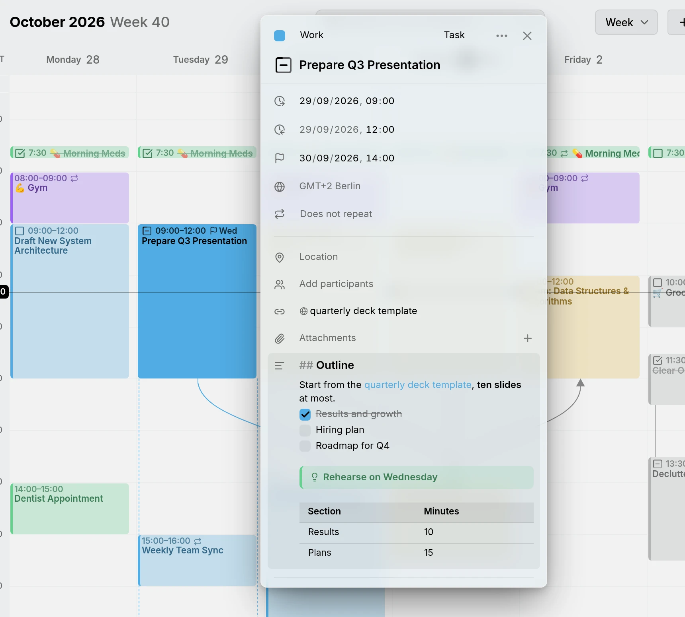
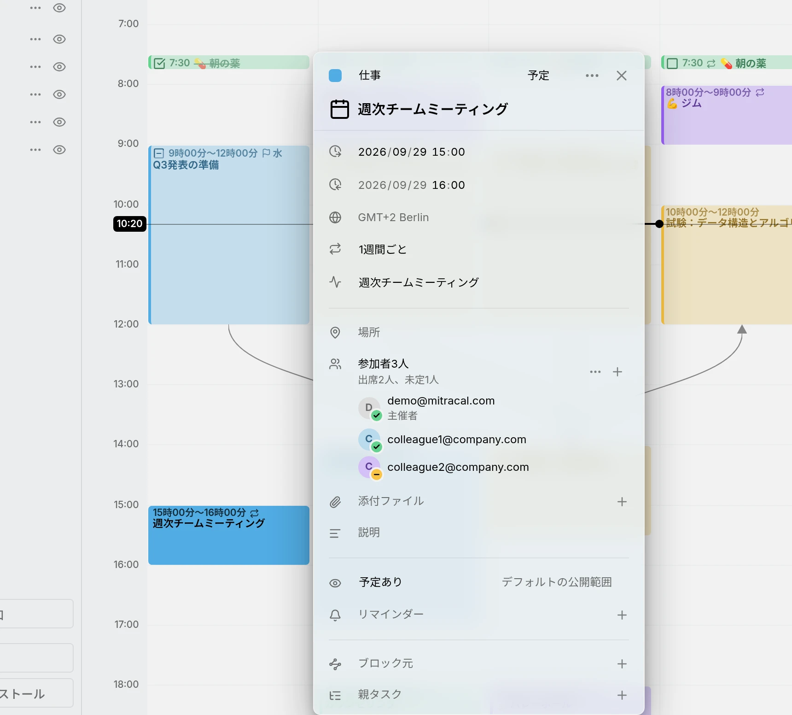

Mitra 0.9 wordt nog gepland. Het brengt grotere klussen samen en laat zien wat er nu kan, laat de zijbalk je eigen manier van denken volgen en schrijft datums zoals jij ze leest.

## Live Markdown-editor
De beschrijving van een item is nu één editor: koppen, lijsten, links, kaders en tabellen zien er opgemaakt uit terwijl je schrijft, en alleen de regel waarop je staat toont zijn Markdown. Vink een punt van een checklist af waar het staat, en maak tekst vet of cursief met Ctrl+B en Ctrl+I (⌘B en ⌘I op een Mac).

<picture>
	<source media="(prefers-color-scheme: dark)" srcset="markdown-description-dark.webp">
	
</picture>

## Betere subtaken
De subtaken van een item delen in de maand- en jaarweergave één rij, zodat een project als één lijn te lezen is, met de korte subtaken erin opgenomen. De tabel toont subtaken onder hun bovenliggende taak, en de jaarweergave kan ze verbergen. De voortgang van een taak houdt rekening met hoe groot elke subtaak is, zodat een lange klus zwaarder weegt dan een snelle, en een afspraak toont de voortgang van de taken eronder. Een subtaak zonder eigen vervaldatum neemt die van de bovenliggende taak over.

## Eigen agendagroepen
Groepeer de agenda's in de zijbalk op je eigen manier, naast groeperen per account, en verberg of toon een hele groep in één keer.

## Uitgebreide landinstellingenbouwer
Kies meer dan een taal en regio: de kalender waarin je datums geschreven worden, de cijfers, de eerste dag van de week en de klok. Een tweede kalender, zoals de Perzische, kan naast je datums staan, en je kunt je huidige tijdzone met de hand instellen.

## Taken die nu kunnen
Planning zet de open taken die door geen andere open taak geblokkeerd worden in een eigen sectie, zodat duidelijk is waar je nu aan kunt werken.

## Waarschuwing bij geblokkeerde taken
Een taak afronden die een andere open taak nog blokkeert vraagt eerst om bevestiging, zodat buiten de volgorde afronden een keuze is en geen ongeluk.

## TickTick-integratie
Koppel je TickTick-account, en de lijsten ervan komen in Mitra als takenagenda's, in beide richtingen gesynchroniseerd.

## Meldingen waar jij bent
Herinneringen bereiken de tools die je al gebruikt, zoals ntfy, Apprise of je eigen webhook.

## Meer talen
Mitra spreekt nu Japans, Koreaans en Vietnamees, elk volledig vertaald, de documentatie en de website inbegrepen. Japans en Koreaans staan in lettertypen die voor hen gemaakt zijn.

<picture>
	<source media="(prefers-color-scheme: dark)" srcset="japanese-week-dark.webp">
	
</picture>

## Bijdragers
- [@a11delavar](https://github.com/a11delavar)
- [@Mugwort150](https://github.com/Mugwort150)
